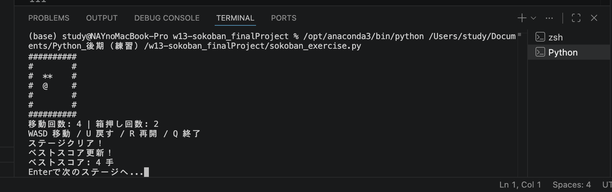

# Sokoban — 倉庫番 改良版

## ゲームの概要
倉庫番は、プレイヤーを操作して箱をゴールまで運ぶパズルゲームです。すべての箱をゴールに移動するとステージクリアになります。

本作品では、配布された倉庫番の演習版をベースに、3つの機能を追加しました。

## 動作環境
- Python 3
- 外部ライブラリ不要（標準ライブラリを使用）

## インストール方法
Python 3をインストールし、GitHubからリポジトリをCloneするか、必要なファイルをダウンロードしてください。

## 起動方法
ターミナルで以下のコマンドを実行します。

`python3 sokoban_exercise.py`

## 操作方法
- W：上に移動
- A：左に移動
- S：下に移動
- D：右に移動
- U：1手戻す
- R：現在のステージをやり直す
- Q：終了

各操作の後にEnterキーを押します。

## 追加・改良した機能

### 1. ステージ選択機能
ゲーム開始時に、プレイしたいステージを番号で選択できるようにしました。無効な番号が入力された場合は、再入力を求めます。

### 2. 箱押し回数カウント
通常の移動回数とは別に、箱を押した回数を表示する機能を追加しました。Undo時には箱押し回数も元に戻ります。

### 3. ベストスコア記録
各ステージの最小移動回数をベストスコアとして記録します。記録は `best_scores.json` に保存され、ゲームを再起動しても保持されます。

## スクリーンショット
ゲームの実行画面のスクリーンショットを追加予定です。

## 既知の問題・制限事項
- ターミナルで動作するテキストベースのゲームです。
- 操作ごとにEnterキーが必要です。
- 動作確認後、確認できた問題があれば追記します。

## クレジット
日本工学院の授業で配布された「第13回 倉庫番・演習版」をベースに改良しました。